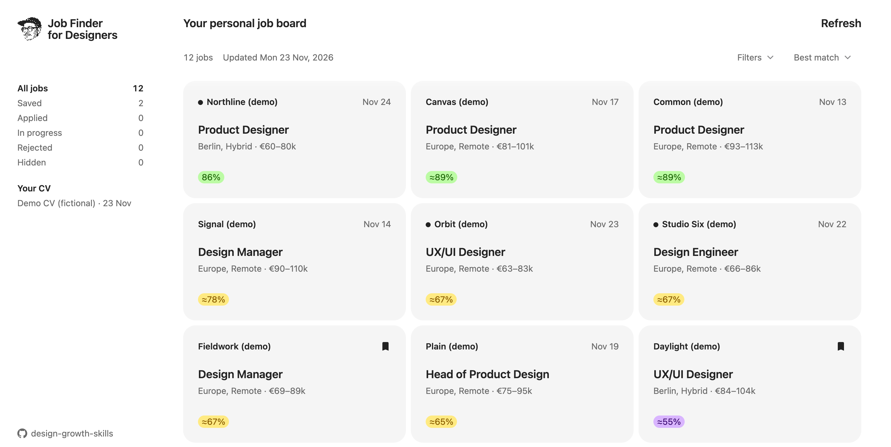

# How Job Finder for Designers works

## 1. In a minute

Job Finder for Designers is a skill for Claude that builds your own job board. You send your CV and answer a few questions. Claude finds vacancies for your roles, level and place, reads the best ones in full and shows how well your experience fits them. You apply yourself, and Claude never sends anything on your behalf.

It's made for Product Designers, UX/UI Designers, Design Engineers, UX Researchers and design leaders. It's in beta.

## 2. Why it's better than a regular job site

- The vacancies come from company career pages on several job platforms at once. You don't need to search each site separately.
- The vacancies are compared with your CV and portfolio, not with a couple of words in a search box.
- For the best vacancies, the match percentage is based on the full posting, not on the title.
- Claude reads the best vacancies and warns you when one is actually open to a single country only or needs US working hours. It doesn't analyse those.
- Everything is in one place, with the status of each application. The board is only yours, and nobody else sees it.

## 3. What you need

- Your CV, as a file or as text.
- A link to your portfolio or website, if you have one. It works without one, but your profile is more accurate with it.
- Claude on a paid plan, Pro or Max.
- 20 to 30 minutes for the first run. Claude does almost all of it on its own.

There's nothing to install.

## 4. Your first run, step by step

**Step 1. Send the link and your CV.** Open a new chat in Claude. Send the link to the [Job Finder](SKILL.md) skill and attach your CV. If you have a portfolio or website, add its link. Claude briefly explains how everything works.

**Step 2. Answer the questions.** Claude asks them in one message. Short answers are fine.
1. Which roles you're looking for.
2. Which level.
3. Where you want to work. A city or a country, and whether remote work across your region or worldwide suits you.
4. Which work format suits you. Remote, hybrid or office.
5. Whether you'd relocate, and where to.
6. Whether you can work US hours.
7. Whether you have a minimum salary. You can skip this one.
8. Which Claude plan you have. Claude can't see it, and the plan decides how much it can do in one go.

Your answers decide which vacancies go into your base. The question about US hours matters because many remote vacancies require them. If you can't work them, Claude skips those vacancies.

**Step 3. Check your profile.** Claude writes a short profile from your CV and portfolio, with your years of experience, skills and tools, product domains and languages. Anything that only your portfolio shows is marked. Your contacts and the text of your CV aren't in it. If everything is right, reply yes. If something is off, correct it. The search doesn't start until you reply.

**Step 4. Wait.** From here Claude works on its own and posts short updates, for example these.
- "I'm putting together your base of vacancies from the list of 26 November."
- "Your base has 113 vacancies, and the board is ready. I'm analysing the 20 best now." This comes about 4 minutes after your yes. You can already open the board and look around, and it fills up as Claude works.
- "I've analysed 10 of 20, they're on the board already."

Sometimes Claude asks you to send it the link to the vacancy list. Just send it in the chat.

**Step 5. The board is ready.** Claude ends with a summary. It says how many vacancies are in your base and how many were analysed, which ones didn't fit your place or hours and why, and which ones couldn't be read. Then it gives you a few tips for a faster search.

## 5. How the board works

*A board with fictional vacancies. Your own board also has a line above the cards with the number of vacancies in your base and the Analyse 20 more button.*

**On the left** are All jobs, Saved, Applied, In progress, Rejected and Hidden, each with its number of vacancies. Below them, Your CV shows which CV Job match is based on.

**The line above the cards** shows how many vacancies you see now and how many are in your base, for example "97 of 113 jobs". Next to it are the date of the list, how many vacancies are analysed and the Analyse 20 more button.

**Filters and sorting.** The Where, Work format, Role, Level, Salary from and Posted filters work across your whole base. They start from your answers, and you can widen them without a new search. The board opens sorted by Best match, with the analysed vacancies at the top. You can also sort by date or salary.

**A card** shows the company, the job title, the place, the work format, the salary when it's stated, and Job match. Job match is how well your CV and portfolio fit the vacancy. The ≈ sign means it's a quick estimate from keywords. Without it, the percentage is based on the full posting. A dot marks new vacancies. You save a vacancy with the bookmark icon, and set its status or hide it in the ⋯ menu.

**The vacancy window.** Click a card to open the details.
- An analysed vacancy has a summary of the posting, its main requirements with their status, strengths, gaps and what to check.
- The others have About this job, the facts from the list next to your profile, such as the years of experience, skills and languages the vacancy asks for.
- If Claude can't read the vacancy's site, the window says so.
- Every window has a link to the original and the Get deep analysis button.

**At the bottom**, Download HTML saves the board as a file.

## 6. Using it day to day

1. **Press Refresh every two or three days.** The vacancy list is updated every morning. Refresh adds new vacancies to your base with your current filters and analyses the best of them.
2. **If you want more analyses, press Analyse 20 more.** Claude analyses the next 20 vacancies.
3. **Get a deep analysis before you apply.** Open a vacancy and press Get deep analysis. In a minute or two the report appears in the chat and on the board. It shows which requirements your experience covers, what your CV doesn't show and what could be clearer in it. Before you apply, open the original and make sure the vacancy is still open.
4. **Mark your statuses.** After you apply, set Applied, then In progress or Rejected. That way no application gets lost.

These three buttons send a request to the chat. Each time, Claude asks in its own window whether the board may send it a message. Press Send.

## 7. How the board gets more accurate

What already works.
- You check your profile before the search starts, so it describes your actual experience.
- The filters you set on the board are saved, and the next Refresh searches with them.
- Each analysis replaces the quick estimate with a percentage based on the full posting. The more vacancies are analysed, the fewer rough numbers are left on the board.
- Vacancies you hide don't come back after Refresh.
- Vacancies that turn out not to fit your place are hidden by the filters. The ones that need US hours say why they don't fit.

What isn't there yet. The board doesn't learn from your analyses and choices, and they don't change the order of the vacancies. That's one of the next steps, described below.

## 8. What's coming next

None of this exists yet. These are plans for the next versions, and the order may change.

- **Tailoring your CV for a vacancy.** Claude suggests how to adjust your CV for a specific vacancy, using only what your CV and portfolio already show, and exports it as a PDF.
- **Cover letter pointers.** Claude points out what to pay attention to, which strengths to lead with and how to present your experience for this vacancy. You write the letter yourself.
- **Company preparation.** Before an interview, Claude gathers the key facts about the company and its product.
- **A review of your whole search.** After several analyses, Claude looks at all the reports together. It shows which gaps repeat from vacancy to vacancy, which domains fit you best and what you could change in your search.

## 9. FAQ

**Which plan do I need, and how much of my limit does it use?**
You need a paid Claude plan, Pro or Max. In a test run on Max 5x, the first run used about 8–9% of the five-hour limit. On Pro that's roughly half of the five-hour limit, by calculation rather than measurement.

**Who can see the board and my data?**
Only you. The board is created in your chat as a private artifact, and its data is available to your account only. The board stores your profile (years of experience, skills, domains and languages), your search conditions, the vacancies, the reports and your choices. The text of your CV and portfolio isn't on the board, and the reports only have short quotes from them. The chat with your CV is kept under Claude's usual rules.

**Where do the vacancies come from, and how fresh are they?**
A shared list of open design vacancies is rebuilt every morning. It comes from the open job dataset by Stapply, which collects postings from company career pages on Greenhouse, Lever, Ashby, Workable and other job platforms. At the end of November 2026 it had about 5,400 design vacancies. Vacancies posted only on LinkedIn or on a company's own site may be missing. Claude checks the analysed vacancies on the employer's site, and the others show the date of the list on the board. More in [where the vacancies come from](../README.md#where-the-vacancies-come-from).

**What do the percentages and the ≈ sign mean? Why is the percentage lower after an analysis?**
Job match shows how much of the vacancy's requirements your CV and portfolio support. With ≈ it's a quick estimate from keywords. Without it, the percentage comes from a table of requirements from the full posting, and required items count twice as much as preferred ones. It isn't an ATS score or a chance of getting an interview. If something isn't in your CV, that doesn't mean you lack the experience.

The quick estimate only sees the keywords in the list. The full posting has more requirements, and your CV may not show some of them. In a test run the quick estimate gave 77% on average and the analysis of the same vacancies 59%. The second number is more accurate, because it takes the whole posting into account.

**Why can't some vacancies be read?**
Some sites don't let assistants read their pages. At the moment Claude can't read postings on Workable, Workday and Gem, and the board marks them. Sometimes it can't read Ashby postings either, for companies with a very long list of vacancies. All of these keep the quick estimate. Open the original link and read the vacancy there.

**Why did a vacancy turn out to be closed?**
The list is built in the morning, and a company can close a vacancy at any time. Analysed vacancies were checked when they were analysed, the others weren't. A deep analysis opens the vacancy again and tells you if it has closed. After Refresh, analysed vacancies that have left the list are marked "not in the latest list". You can remove a closed vacancy with Hide in the ⋯ menu.

**Does it work in ChatGPT or on the free Claude plan?**
This hasn't been tested yet. On the free plan, Claude is meant to show the 10 best vacancies as a list in the chat, without a board. In ChatGPT and other assistants, the vacancies and reports come in the chat too.

**Does Claude apply for me?**
No. Claude doesn't apply for vacancies and doesn't write to employers or recruiters. It finds vacancies, analyses them and points out what to pay attention to. You apply yourself, through the link to the original.

**How do I get back to the board the next day?**
Open the board from the Artifacts list in Claude and continue from there. If you open a new chat and ask it to update the board, Claude can only look at the board from there.

**Can I analyse a vacancy I found somewhere else?**
Yes. Send the link or the text of the vacancy in the chat and ask for an analysis. Claude compares it with your CV and portfolio, and the report comes in the chat.

**Can I download the board?**
Yes, with Download HTML at the bottom of the board. The file opens in any browser, where you can look through the vacancies, filter them and set statuses. It's a snapshot from the moment you downloaded it. The file itself doesn't update, and your changes in it stay in that browser only. Refresh and the deep analysis work only in Claude. The file contains reports with short quotes from your CV, so be careful who you send it to.

## 10. Limits and feedback

- This is a beta. So far everything has been tested in Claude on the web, on the Max 5x plan, with fictional CVs from Lisbon and London. The free and Pro plans, the Claude desktop and mobile apps, ChatGPT, roles beyond Product and UX/UI Designer, and other cities haven't been tested yet.
- The list only has vacancies from the job platforms in the Stapply dataset.
- Sometimes a vacancy in the list is marked as remote worldwide but is actually open to one country only. Claude sees this only for the vacancies it reads.
- Job match compares documents, not people. It isn't a hiring decision.

If something doesn't work as described here, please [open an issue on GitHub](https://github.com/egor-krasnoperov/design-growth-skills/issues).
